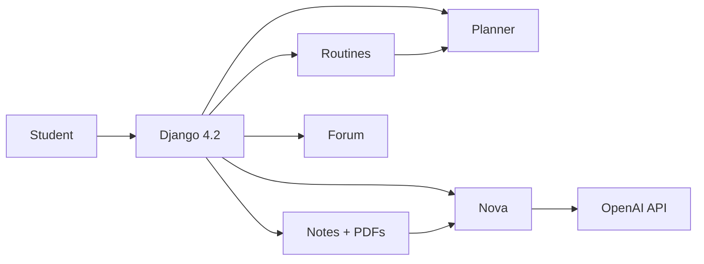

# ULAB StudyConnect

**One academic hub for University of Liberal Arts Bangladesh.**  
Exam routines, AI-assisted notes, intelligent study plans, campus forum, and Nova — a ChatGPT-powered tutor — in a single premium web platform.

Built for **ULAB Hackathon 2026**.

<p align="center">
  
  
  
  
</p>

---

## Why this exists

ULAB students juggle **exam Excel sheets**, scattered **Drive notes**, group-chat answers that vanish, and last-minute **study calendars**. StudyConnect replaces that chaos with one signed-in workspace:

| Instead of… | Students get… |
| --- | --- |
| Unsearchable exam Excel files | Parsed routines, filter by course & section, save a personal set |
| Notes lost in Messenger | Public / private notes, PDFs in-browser, YouTube on the same page |
| Guessing what to study tonight | A day-by-day plan from official dates and course difficulty |
| Repeating the same CSE question | A campus forum with votes, answers, and comments |
| Generic ChatGPT with no campus context | **Nova** — a tutor that knows StudyConnect and ULAB study habits |

---

## Product surface

### Home & identity
- Marketing home with a 3D floating product scene, About / Mission / Team / Blog
- Register, login, logout, and a **Profile** dropdown in the premium navbar
- Dashboard for signed-in students
- Department, course catalog, and semester on the user profile

### Exam routines
- Upload / replace / delete official **Excel** schedules
- Tabular + grid parsing of midterm / final sheets
- Filter by course code and section
- **Saved selections** without exploding form field limits
- Detail views for uploaded files and personal saved routines

### Study planner
- Generate a plan from an **uploaded official routine** (not only a saved subset)
- Date range (up to 90 days), hours per day, course checklist with search & select-all
- Difficulty-weighted blocks; nearer exams get more time
- Review-mode when exam dates are already in the past
- Save, list, and delete plans

### Notes & resources
- Create, edit, delete notes; default **public** gallery for campus sharing
- Attach / replace / delete PDFs on a note
- In-page **PDF.js** viewer (no broken localhost iframe)
- YouTube links (watch, shorts, live, youtu.be) embedded without Error 153
- **Summarize** and **Quiz** tools from note or pasted text
- Public PDFs visible when the parent note is public

### Forum
- Questions and discussions, search and filters
- Answers, nested comments, up / down votes (POST)
- Plain-text posts rendered safely (line breaks, no raw HTML)

### Nova AI
- Full-page tutor plus a floating dock on other pages
- Powered by **OpenAI Chat Completions** (`OPENAI_API_KEY` in `.env`)
- Markdown rendered as clean headings, lists, and emphasis — not raw `###` / `**`
- Session history, clear chat, suggested prompts
- Honest errors if the API is unreachable (no silent fake replies)

---

## Architecture

```
ULAB_Study_Connect/
├── ULAB/                 # Django project (settings, URLs, WSGI/ASGI)
├── users/                # Auth, profile, home, dashboard, campus pages
├── routines/             # Excel upload, parse, filter, saved routines
├── planner/              # Study-plan engine + CRUD
├── notes/                # Notes, PDFs, summarize, quiz
├── forum/                # Community Q&A
├── chatbot/              # Nova engine + API
├── templates/            # Shared premium UI
├── static/css|js         # Design system & interactions
└── media/                # Uploaded PDFs and routine files
```



Core apps wired in `ULAB/settings.py`: `users`, `routines`, `planner`, `notes`, `forum`, `chatbot`.

---

## Tech stack

| Layer | Choice |
| --- | --- |
| Backend | Django **4.2**, class-based views, SQLite (dev) |
| Auth | Django auth + `UserProfile` (department, semester) |
| Files | Django `FileField` + `/media/` in development |
| AI | OpenAI Chat Completions (`gpt-4o-mini`), optional Groq fallback |
| PDF | PDF.js in the browser, `FileResponse` for download |
| Frontend | Custom design system (`static/css/style.css`), Inter + Plus Jakarta Sans, Font Awesome |
| Config | `.env` loaded at startup (`OPENAI_API_KEY`, `OPENAI_MODEL`) |

---

## Getting started

**Requirements:** Python 3.10+ (3.11+ recommended)

```bash
cd ULAB_Study_Connect
python3 -m pip install django
```

Create a `.env` in the project root (never commit this file):

```env
OPENAI_API_KEY=sk-your-key
OPENAI_MODEL=gpt-4o-mini
```

Apply migrations and run:

```bash
python3 manage.py migrate
python3 manage.py runserver 127.0.0.1:8000
```

Open **[http://127.0.0.1:8000/](http://127.0.0.1:8000/)**.

| Path | What you see |
| --- | --- |
| `/` | Home |
| `/accounts/register/` | Join |
| `/dashboard/` | Signed-in hub |
| `/routines/` | Exam schedules |
| `/planner/` | Study planner |
| `/notes/` · `/notes/public/` | My notes · campus gallery |
| `/forum/` | Community |
| `/chat/` | Nova AI |

Admin: `/admin/` after `python3 manage.py createsuperuser`.

---

## Design language

StudyConnect is built as a **product**, not a default Django admin skin:

- Indigo / cyan academic palette, glass hubs, and a living hero scene
- Consistent nav: Home, Dashboard, Routines, Planner, Notes, Forum, Nova, Profile
- Empty states, breadcrumbs, and action rows on every workspace page
- Accessible structure (landmarks, labels, CSRF on every mutating request)

---

## Hackathon narrative

**Problem:** ULAB academics live in too many tabs.  
**Product:** One signed-in campus OS for exams, notes, plans, peers, and AI.  
**Differentiator:** Official routine files drive the planner; Nova is campus-aware; notes and PDFs are actually shareable.

---

## Team note

This repository is the ULAB StudyConnect hackathon build. Treat `.env`, `SECRET_KEY`, and uploaded student files as private. Prefer `/usr/bin/git` workflows that never commit `db.sqlite3` or API keys.

---

<p align="center">
  <strong>ULAB StudyConnect</strong> · Study. Connect. Grow together.<br />
  <sub>Hackathon 2026 · University of Liberal Arts Bangladesh</sub>
</p>
